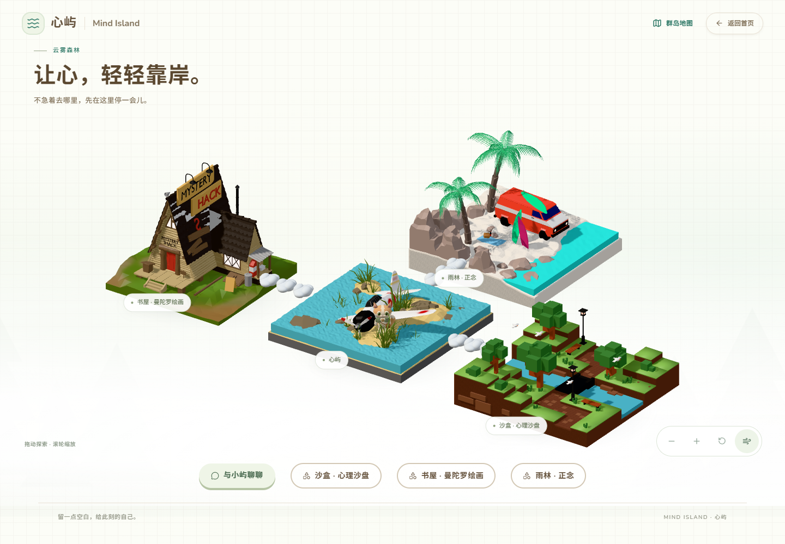

# Mind Island · 心屿

一片可以停下来聊天和创作的群岛。当前本地版本 **V0.9.0（雨林正念岛待视觉与功能验收）**，面向桌面与手机浏览器。

已包含动态果冻岛、原创陪伴猫“小屿”、真实流式 AI 对话、本机历史会话，以及默认关闭、用户授权后启用的自动长期记忆。小屿是 AI 陪伴角色，不是心理治疗师。

[沙屿多作品管理](docs/SANDPLAY_DEMO_V07.md)：从果冻岛进入 `/sandplay`，保留完整原版 80 种沙具，新增本机 SQLite 作品库、自动保存与主动导入浏览器旧存档，不发送给 AI。

[双岛场景说明](docs/ISLAND_WORLD_V072.md)：用户提供的飞机岛与溪流小岛、三朵悬浮云、沙盘点击导航；页面统一白色背景，聊天区保留对话与必要操作。

[Animal Island UI 接入记录](docs/UI_REFACTOR_ANIMAL.md)：实际使用圆润按钮、开关、输入框和卡片，保持白色背景与精简聊天。

[群岛首页视觉实验](docs/FOREST_HOME_EXPERIMENT.md)：近白云雾森林、可拖动旋转和缩放的双岛视角，以及轻量群岛地图。

[曼陀罗书屋](docs/MANDALA_DEMO_V080.md)：`/mandala` 提供 6 幅原创 SVG 涂色（小猫、鱼、星月、蝴蝶、拼花、小屋）和复用 MIT Mandala Maker 的对称绘画；用户提供的小木屋成为第三座功能岛。作品暂不存库，请导出 PNG 留存。

[雨林正念岛](docs/RAINFOREST_MINDFULNESS_V090.md)：`/mindfulness` 提供可按压回弹的近景模型及独立音频播放器；首页四岛 T 字布局，三条云朵连接。正式音频待添加，清单位于 `frontend/src/components/Mindfulness/mindfulnessTracks.ts`。



真实 DeepSeek 记忆提取、跨会话注入与更新的验收及最小修复见 [V0.7.1 报告](docs/MEMORY_LIVE_VALIDATION_V071.md)。正式用户记忆未修改，自动记忆仍需主动授权。

## 本机启动

需要 Git、Bun **1.4.4**、Python **3.13**。此 Demo 不需要 Docker、PostgreSQL 或模板的完整后端。

从根目录在 PowerShell 执行：

```powershell
bun install --frozen-lockfile
py -3.13 -m venv backend/.venv-demo
backend/.venv-demo/Scripts/python.exe -m pip install -r backend/demo_ai/requirements-dev.txt
Copy-Item backend/demo_ai/.env.example backend/demo_ai/.env.local
```

仅首次创建配置文件，已有文件请保留。默认 `AI_MODE=mock`，无需密钥即可预览。

终端一：

```powershell
Set-Location backend
.\.venv-demo\Scripts\python.exe -m demo_ai
```

终端二，从项目根目录运行：

```powershell
bun run dev:demo
```

打开 <http://127.0.0.1:5174/island-preview>，点击小屿或“与小屿聊聊”。只有前端运行时仍可预览 3D 场景，聊天与 SQLite 作品库需要本机代理；原版沙盘和浏览器存档仍可独立使用。

真实 AI 配置填写在 **`backend/demo_ai/.env.local`**：

```dotenv
AI_MODE=live
AI_API_KEY=填写你的供应商密钥
AI_BASE_URL=填写供应商的兼容 API 基础地址
AI_MODEL=填写模型名称
```

修改后重启代理。只使用服务端变量，不要创建包含密钥的 `VITE_*` 变量。可选独立记忆提取模型与费用限制见 [开发指南](docs/DEVELOPMENT.md)。

## 开发入口

- [简明项目上下文](docs/PROJECT_CONTEXT.md)：继续开发时先读这一份。
- [开发指南](docs/DEVELOPMENT.md)：环境、验证、数据库和隐私边界。
- [版本记录](CHANGELOG.md) · [历史交付记录](docs/history/)
- [文件整理与版本管理记录](docs/REPOSITORY_MAINTENANCE.md)
- [桌面截图](docs/screenshots/memory-v05-desktop.png) · [手机截图](docs/screenshots/memory-v05-mobile.png)
- [代码协作约定](AGENTS.md) · [模板来源与保留功能](docs/UPSTREAM.md)

```text
frontend/src/components/IslandPreview/  # 既有岛屿与角色
frontend/src/components/Chat/           # 聊天、会话与记忆信箱
frontend/src/components/Mandala/        # SVG 涂色、对称创作与 PNG 导出
frontend/public/models/                # WebGL 运行资产
backend/demo_ai/                       # 独立本机代理与 SQLite
assets/blender/                        # 可编辑 Blender 工程、脚本和导出
docs/                                 # 当前说明与历史归档
```

## 数据与安全

历史及记忆保存在本机 `backend/demo_ai/data/mind_island_demo.sqlite3`，未加密。自动提取与记忆使用均默认关闭；临时聊天不读取或生成长期记忆。

授权提取会通过已配置的大模型 API 处理相关内容，可能增加费用。密钥、数据库、开发备份、缓存与测试原始记录不进入 Git。代理仅监听本机，不应直接暴露到公网。

本项目基于 [Full Stack FastAPI Template](https://github.com/fastapi/full-stack-fastapi-template)，保留其 MIT [许可证](LICENSE)与现有模板功能。
