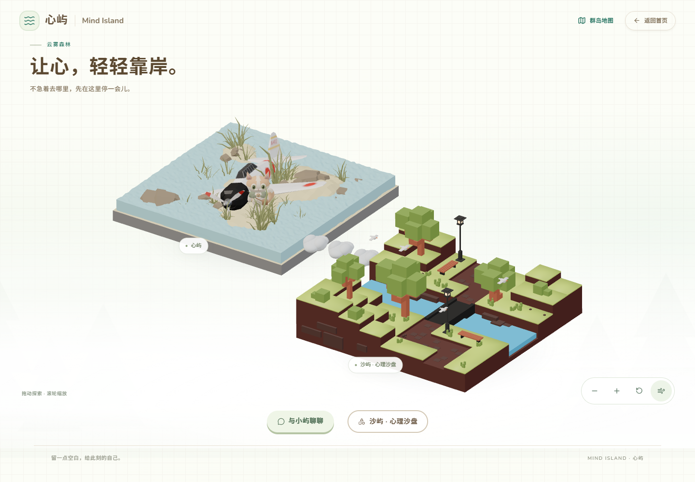

# 群岛首页「云雾森林」视觉实验

日期：2026-10-25。入口：<http://127.0.0.1:5174/island-preview>。

## 范围

仅调整群岛首页的背景、构图、相机交互和导航表现。未修改后端、SQLite、AI 聊天组件或沙盘功能，未改 GLB，没有新增依赖或功能岛。

保留近白底色 `#fdfefb`，以淡绿光晕、低透明度 SVG 远树、Animal Island UI 的 Background 网格和两层缓慢 CSS 薄雾形成层次。装饰全部放在独立背景组件内，`pointer-events: none` 且 `aria-hidden`，位于模型和交互内容后方。原 Canvas 改为透明清屏，仍然只有一个 WebGL Canvas。

背景动画按钮只控制 CSS 薄雾，不暂停岛屿的默认运动。页面隐藏、地图打开或系统减少动态时背景暂停；减少动态模式也关闭相机惯性。偏好仅在当前页面内保存，不写浏览器持久化或数据库。

## 相机与地图

- 缩小标题占用，增加场景高度；按每个模型网格的实际包围盒取景，减少空白区域。
- 使用已有 Drei OrbitControls，支持鼠标拖动旋转、滚轮缩放、单指旋转和双指缩放。
- 缩放范围 0.75–1.75；旋转限制在适合观察地面的范围，关闭平移。放大后可查看局部，初始取景保证双岛完整可见。
- 提供 HTML 放大、缩小、复位按钮，可通过键盘操作；复位前清除残留惯性，避免复位后继续漂移。
- 通过位移与多指手势保护，防止拖动或抬起静止手指时误触聊天和导航。
- 两岛悬停都显示名称与介绍，保留原点击行为及 HTML 入口。
- 群岛地图复用实际 Card / Title 组件，工具提示使用实际 Tooltip。地图以现有岛屿配置的 X/Z 坐标生成示意，只展示两个已启用岛屿，未来配置扩展时自动列出。
- 地图中心标记和列表都可点击；心屿打开原聊天面板，沙屿进入原 `/sandplay`。关闭地图后焦点回到入口，选择功能时不抢占聊天焦点。

## 实际验证

浏览器均拦截为明确 Mock / 空历史，不调用真实供应商，不访问用户聊天正文，不发送测试消息。沙盘仅验证原页面加载与返回，未保存作品。

| 验证 | 结果 |
| --- | --- |
| 默认桌面和手机竖屏构图 | 通过；实际顶点投影无初始裁切 |
| 桌面鼠标拖动、滚轮、按钮缩放、复位 | 通过 |
| 拖动结束不误触岛屿 | 通过 |
| 手机单指拖动、双指缩放 | 通过；包含静止手指先抬起的情况 |
| 3D 小屿点击 / 手机触摸打开聊天 | 通过 |
| 地图打开聊天、进入沙盘、沙盘返回 | 通过；离开首页无残留 Canvas，返回无残留 iframe |
| 地图 Escape 关闭与焦点恢复 | 通过 |
| 背景开关及系统减少动态 | 通过；减少动态下地图标记仍可点击 |
| 背景不拦截鼠标 | 通过；所有装饰子节点 pointer-events 为 none |
| 页面不可见时停止计算 | 通过；WebGL 帧数不再增长，背景 CSS 暂停 |
| 普通状态变化不重复请求 GLB | 通过；三个模型各加载一次 |
| 手机聊天展开后场景工具条 | 隐藏，避免遮挡缩小后的模型；桌面仍可操作 |
| 正常测试页面异常 | 未发现 pageerror；保留原有 THREE.Clock 弃用提示 |

测试期间修正：减少动态模式的通用 hover 规则会取消地图标记用于居中的 transform，造成点击偏移；标记现使用固定 margin 居中，不再依赖动画 transform。

执行 `check:demo`、TypeScript / Vite 构建、岛屿配置测试、沙盘数据测试和仓库资产检查。结果见下方交付摘要。未修改后端实现，本轮不重跑后端整套测试。

## 文件

新增：

- `frontend/src/components/IslandPreview/ForestAtmosphere.tsx`
- `frontend/src/components/IslandPreview/ArchipelagoMap.tsx`
- `frontend/src/components/IslandPreview/forest-experiment.module.css`
- 本报告和 `docs/screenshots/forest-*.png`

修改：

- `IslandPreviewPage.tsx`：实验装饰、地图、背景和视角控制入口。
- `IslandScene.tsx`：透明清屏、精确包围盒、悬停说明和手势保护。
- `WorldCamera.tsx`：有边界的交互相机、复位和缩放。
- `island-preview.module.css`：近白构图、主视觉比例和悬停卡片。
- README 与当前项目上下文。

实验装饰组件与样式只在首页引用，不覆盖全站主题。所有此前未提交改动保留，未进行提交、推送或大型重构。

## 截图

[手机竖屏](screenshots/forest-home-portrait.png) · [岛屿悬停](screenshots/forest-island-hover.png) · [桌面地图](screenshots/forest-map-desktop.png) · [手机地图](screenshots/forest-map-portrait.png) · [桌面聊天](screenshots/forest-chat-desktop.png) · [手机聊天](screenshots/forest-chat-portrait.png)

## 交付摘要与限制

- Biome：48 文件通过；TypeScript 与 Vite 构建通过。
- 岛屿 3 项、沙盘 4 项、仓库/原资产 7 项自动化测试通过，仓库检查无错误。
- 没有新增图形库或 WebGL Renderer。3D bundle 约 1.09 MB，保留现有大包提示。
- 手机使用 Chromium 触摸模拟，尚未进行实体手机 GPU / 软键盘实测。
- 地图是功能导航示意，不是角色行走或寻路系统。本轮等待视觉验收。

## 模型色彩与光影调整

2026-10-25：根据视觉反馈，将 AgX / 1.2 曝光改为 Neutral / 1.0，降低均匀补光、突出暖色主光；仅对运行时克隆材质调整青蓝水面、森林绿与暖土色，原始 GLB 和角色配色不变。增加一盏 1024×1024 PCF 阴影，使用背面投影避免双面网格条纹。无新增依赖或后处理。

Biome 49 文件、TypeScript / Vite、3 项岛屿测试通过；桌面/手机触摸模拟的拖动、缩放、复位、聊天入口、地图及沙盘往返通过，3 个 GLB 仅各加载一次，未发现页面异常。全程拦截 API 为 Mock，未读取用户对话或调用供应商。单帧统计约 278 次绘制（含阴影），低性能实体设备尚待实测；保留既有 chunk 大小和 THREE.Clock 提示。

[调整后桌面](screenshots/forest-lighting-desktop.png) · [调整后手机](screenshots/forest-lighting-portrait.png)
