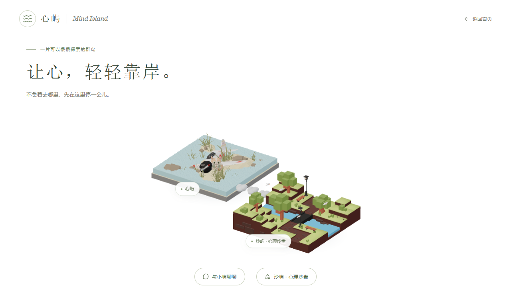
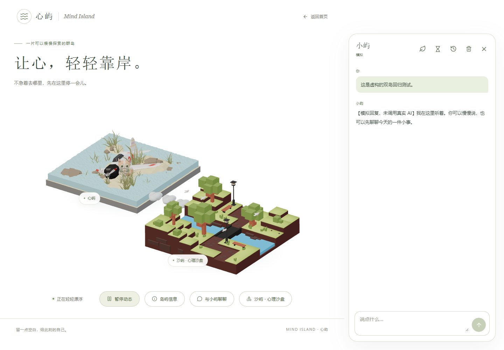

# Mind Island V0.7.2 双岛交付

日期：2026-10-25。本地待视觉验收。实际地址：<http://127.0.0.1:5174/island-preview>。

## 最终范围

使用用户提供的「飞机失事」作为可见心屿，「小岛」作为沙屿。保留小屿模型、聊天、历史、记忆和沙盘多作品管理。依据本轮追加要求，页面背景统一白色，聊天去掉介绍与辅助说明，岛间只保留 **3 朵独立悬浮云**。不再把手机横屏列为专项验收目标。

本轮没有新增业务依赖，没有调用真实 DeepSeek，没有修改后端代码、数据库结构或服务端配置。未开发角色行走。

后续极简调整：去掉首页暂停动态、岛屿信息按钮、动态状态文字及“02 心屿与沙屿”编号。默认保持运动，系统减少动态设置和页面不可见时的暂停仍然有效。对应无用状态和 CSS 同步清理；类型检查、Vite 构建及 Biome 通过，桌面与竖屏截图已更新。

## 源模型检查与导出

两份 Downloads 源文件已原样复制，原件和项目内副本 SHA-256 均与开发前一致。

| 项目 | 飞机心屿 | 溪流沙屿 |
| --- | --- | --- |
| 项目源文件 | `assets/blender/islands/home/source/plane_crash_island.blend` | `assets/blender/islands/sandplay/source/sandplay_island.blend` |
| 原场景对象 | 46，包括 43 个 Mesh | 51，包括 48 个 Mesh |
| 实际结构 | 沙地、水面、飞机残骸、石块、草丛 | 分层地块、草地、溪流、内部石桥、树、长椅、灯和鸟 |
| 排除预览对象 | GameIsoCam、Area.001、Area.002、bg | Camera、Sun、Area、Bg |
| GLB | `frontend/public/models/islands/home-island.glb` | `frontend/public/models/islands/sandplay-island.glb` |
| 文件字节 | 2,737,244 | 262,340 |
| 导出 Mesh / 三角面 / 材质 | 42 / 46,360 / 11 | 47 / 4,416 / 11 |
| 实际 Y-up 尺寸 X×Y×Z | 8 × 3.0871 × 8 m | 8 × 4.7201 × 8.0769 m |
| 独立场景重新导入 | PASS，面数、尺寸一致 | PASS，面数、尺寸一致 |

Blender 实际版本 5.2.3 LTS；源文件为米制，Z-up，地块围绕原点。导出为 glTF Y-up，网页不再重复旋转。沙屿原有石桥仅横跨内部溪流，不用于连接两座岛。

飞机贴图 `plane-uv.jpg` 已内嵌 1024×1024 图像，可正常导出，不依赖失效的外部贴图路径。原飞机文件的刚体依赖存在循环提示，导出副本在第 1 帧冻结已求值 Mesh，不保留物理依赖。仅对导出副本的密集草丛使用 0.35 比例简化，模型三角面从 96,060 降至 46,360。两模型水面在导出副本改为不透明风格化材质，避免昂贵透射；沙屿 Emission 材质转换为兼容的 Principled 材质。源文件不保存、不覆盖。

可重复执行命令（项目根目录，PowerShell）：

```powershell
& 'C:/Program Files/Blender Foundation/Blender 5.2/blender.exe' --background --factory-startup --disable-autoexec --python assets/blender/islands/scripts/export_islands.py
```

脚本打开源文件时禁用脚本；只导出当前 Web_Export 场景的模型，不包含相机、灯光、骨骼或动画。每岛保留 `source/inspection.json`、`source/manifest.json`、`export-report.json` 和 `renders/isometric.png`。重新导入验证实际执行通过；原果冻岛与小屿 GLB 的 SHA-256 未变。

## 世界布局与相机

全部世界坐标单位为米，Y-up，以下为共同漂浮变换之前的静态坐标。

| 对象 | 平移 / 缩放 | 世界包围盒或位置 |
| --- | --- | --- |
| 心屿 | `[-5.8, 0, -1.8]` / 1 | min `[-9.8,-0.3519,-5.8]`，max `[-1.8,2.7352,2.2]` |
| 沙屿 | `[5.4, 0, 1.8]` / 1 | min `[1.4,-0.2,-2.2]`，max `[9.4,4.5201,5.8769]` |
| 小屿 | `[-4.3,1.20003,0.2]` / 1.5 | 前侧沙地，网页射线测得地面 1.200026 |
| 沙屿入口 | `[3.2,0.65,0.4]` | 网页射线测得地面 0.650000 |

两岛 X 方向边界间隔 3.2 m，不互相穿插。相机仍是原 Canvas 内的正交相机；桌面基础位置 `[12.5,12,18]`，竖屏 `[19,16,9]`，按实际包围盒、角色和标签自动居中取景，窗口及聊天布局变化时重新计算。实际几何顶点投影检查通过，桌面和 390×844 竖屏无裁切。

页面、Canvas、聊天、沙盘外层和旧沙盘运行副本底色设为白色；保留模型原配色、按钮与消息气泡配色。模板认证布局及全局页面背景也同步为白色。没有修改只读 V15 HTML。

## 云朵与未来路径

`island-world.ts` 统一维护岛屿 ID、名称、描述、资源、路由、坐标、旋转、缩放和启用状态。`CloudBridge.tsx` 使用一个 InstancedMesh 绘制三朵简洁的小云，每朵由少量低细分椭球组成，中心为：

- `[-1.35,1.05,0.54]`
- `[-0.2,1.1,0.47]`
- `[0.95,1.05,0.4]`

两岛、云朵和角色全部位于 `Island_World_Motion` 下，同步漂浮、呼吸和轻摇；云朵没有独立位移，不会相对岛屿漂走。减少动态、页面隐藏及暂停设置继续生效。

预留的未来路径端点为心屿 `[-3.8,1.0636,0.7]` 和沙屿 `[2.4,1.05,0.3]`；网页射线验证高度分别为 1.063604 和 1.050000。中间路径点、建议宽度 1.65 m、小屿出生点、沙屿入口和两岛初始安全区域均保存在配置中。区域与装饰模型分离，后续高度采样依据明确的地形节点。

**按最终要求，云朵之间保留间隔；这些云朵不是连续可行走桥面。** 路径点只是数据准备，下一轮需先确定踏云、跳跃或隐藏连续导航面，再实现碰撞、避障和行走，不能直接把当前视觉云当作已完成的桥梁物理表面。

## 交互与聊天精简

沙屿采用低成本包围盒拾取，不对密集草丛与装饰逐个射线检测。悬停显示指针、轻微高亮和功能说明；点击后约 220 ms 柔和反馈进入已有 `/sandplay`。减少动态时直接导航。保留键盘可操作的 HTML 入口和沙盘返回按钮。

小屿仍沿用现有组件与动作接口。点击播放 Greeting，Mock 流式回复期间 Responding，完成后 Idle。没有按 token 重建模型。聊天区删除角色介绍、欢迎语、底部存储介绍、Enter 说明和字数提示；历史、记忆、临时聊天改为简洁图标入口，均带可访问名称。保留发送、停止、重试、关闭、必要错误和模式反馈；模拟环境显示简短“模拟”标记。记忆授权与管理页面的必要隐私说明不受影响。

## 实际验证

| 检查 | 结果 |
| --- | --- |
| 两 GLB 独立重新导入 | PASS；材质、面数、尺寸、相机灯光排除验证通过 |
| 双岛、角色、云朵 | PASS；同一运动父级；桌面与竖屏实渲染检查 |
| 小屿脚底、入口与桥头高度 | PASS；网页地形射线实测，修正沙屿桥头预估偏差 |
| 沙屿悬停、3D 点击、沙盘返回 | PASS；桌面鼠标、竖屏触摸 |
| 小屿 3D 点击、三动作 | PASS；Greeting → Responding → Idle，Mock SSE |
| 历史恢复与记忆信箱 | PASS；刷新恢复虚构对话，信箱可打开 |
| 三作品、自动保存、刷新恢复 | PASS；独立测试库，完整场景 JSON 一致 |
| 作品失败重试、重命名、删除确认 | PASS；失败不冒充保存成功 |
| 80 沙具、9 分类、四视角、主题、尺寸 | PASS；原工厂全部可创建 |
| 沙具编辑、飞行高度、浏览器存取、PNG | PASS；现有流程回归，无 AI 请求 |
| 页面隐藏、减少动态 | PASS；隐藏后渲染帧停止，减少动态矩阵保持不变 |
| 路由卸载 | PASS；离开首页无残留首页 Canvas，观察到几何体释放；返回首页无残留沙盘 iframe |
| 模型请求失败、WebGL 不可用 | PASS；显示有效静态 PNG，HTML 入口可用 |
| 正常场景控制台与资源 | PASS；未见 console error 或模型加载失败；保留既有 Clock 弃用警告 |
| 正式数据保护 | PASS；全部既有行与备份一致，未删除或覆盖；源资产校验一致 |

UI 回归代理独立监听 `127.0.0.1:8002`，使用 `output/island-world-v072/ui-test.sqlite3` 和 `AI_MODE=mock`；浏览器测试请求受控转发到该代理，不写正式库。测试后台在完成后关闭。用户原前端与默认代理保留运行。截图仅含虚构 Mock 对话，真实供应商调用 **0 次**。

正式库中途核对时九表一致；最终核对发现运行中的默认代理并行新增了 1 个会话、2 条消息和 1 个记忆任务，新增内容不匹配本轮 UI 测试文本。既有所有行均未变化，记忆条目、记忆来源及作品表保持一致。保留这些并行新增记录，未用备份回滚。审计只记录条数、状态和时间，不输出正文。

自动化执行：

- 后端 unittest：**98 项通过**，独立临时 SQLite / Mock。
- `test:islands`：**3 项通过**，GLB 格式与材质、坐标变换、布局路径引用。
- `test:sandplay`：**4 项通过**。
- `scripts/tests`：**7 项通过**，含原版 V15 字节完整性与已删除文件检查。
- `check:demo`、额外修改文件 Biome、TypeScript 与 Vite build：通过。
- 后端 Ruff check / format --check：通过；导出脚本 Ruff：通过。
- 仓库隐私/生成文件检查：通过；本轮不提交或推送已有工作区改动。

## 本轮文件清单

新增：

- `assets/blender/islands/scripts/export_islands.py`
- `assets/blender/islands/home/`、`sandplay/`：原始 source、manifest、inspection、导出报告和模型预览。
- `frontend/public/models/islands/home-island.glb`、`sandplay-island.glb`、`island-world-preview.png`
- `frontend/src/components/IslandPreview/island-world.ts`、`WorldCamera.tsx`、`CloudBridge.tsx`
- `frontend/tests/island-world.test.mjs`
- 本报告和下方四张验收截图。

修改：

- `IslandPreview/IslandScene.tsx`、`IslandPreviewPage.tsx`、`island-preview.module.css`
- `Chat/ChatPanel.tsx`、`ChatComposer.tsx`、`chat.module.css`；删除已不用的 `Chat/EmptyChat.tsx`。
- `Sandplay/sandplay.module.css`、`public/legacy/sandplay-host.css`：白色底色。
- `Common/AuthLayout.tsx`、`src/index.css`、`src/routes/island-preview.tsx`
- `frontend/package.json` 与 `.github/workflows/demo-ci.yml`：新增岛屿测试命令及 CI 检查；依赖无新增。
- `scripts/check_repository.py`、`scripts/tests/test_check_repository.py`：修复检查器读取已删除工作区文件时报错，暂存区扫描仍读取 Git index；新增回归测试。
- `README.md`、`CHANGELOG.md`、`docs/PROJECT_CONTEXT.md`、`docs/DEVELOPMENT.md`

其他已有 V0.6/V0.7/V0.7.1 未提交改动全部保留，不能将这些既有改动误归为本轮后端修改。

## 实际截图





[手机竖屏双岛](screenshots/island-world-v072-portrait.png) · [手机竖屏聊天](screenshots/island-world-v072-portrait-chat.png)

## 限制与下一轮准备

3D 页面压缩 JS 约 1.06 MB，仍有 Vite 大 chunk 提示；实际场景约 61,114 三角面、142 draw calls，未做实体低端手机帧率测量。DPR 上限 1.5，未新增后处理或实时透射。原资源组件保留卸载释放机制。

相机是固定角度，尚未实现自由探索；三朵云不是连续行走桥面。步行区域只是小范围起始数据，不是全岛 navmesh。下一轮需补实际障碍与坡面检测、可走连接面、路径规划、角色行走/转向动画、目标岛到达交互，再考虑移动控制器。实体手机软键盘及 GPU 性能仍需实机验收。本轮不继续开发。
