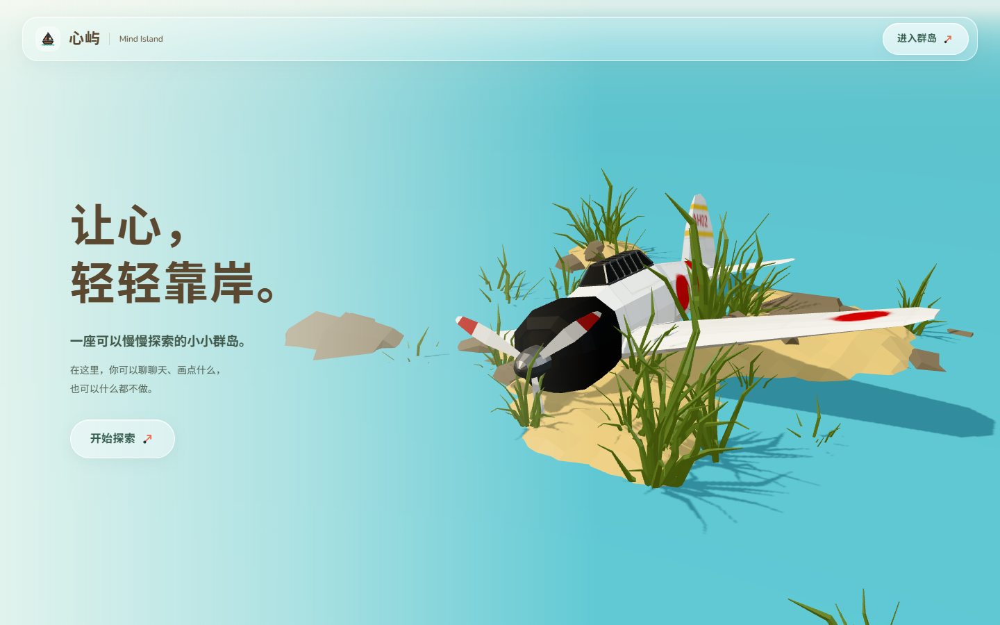
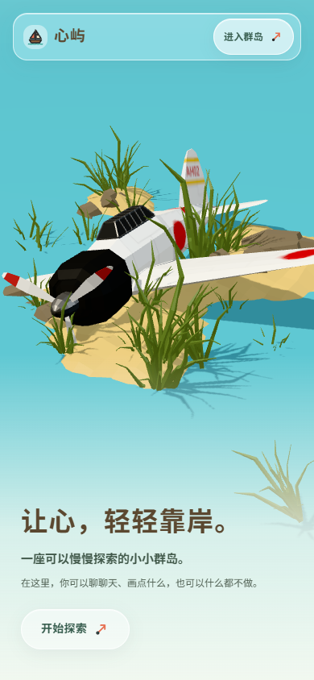

# 心屿 · 沉浸式品牌入口

2026-10-26。本轮新增公开入口，不替换群岛场景。等待视觉验收。

## 访问与路由

- 品牌入口：<http://127.0.0.1:5174/>
- 「开始探索」「进入群岛」均进入原 `/island-preview`。
- 根据本轮追加要求，群岛页顶栏「心屿 / Mind Island」成为可键盘访问的返回入口链接；保持原排版。
- 群岛原有入口仍前往 `/sandplay`、`/mandala`、`/mindfulness`；各页面「返回」仍回到群岛。
- 原根路径是受登录保护的模板 Dashboard，原组件完整移至 `routes/_layout/dashboard.tsx`，访问路径为 `/dashboard`。登录成功、已登录访问注册/密码页、管理员权限回退、模板侧栏与模板 Logo 均更新目的路径，认证及表单逻辑不变。
- `routeTree.gen.ts` 由现有 TanStack Router 插件生成。公开根页不经过模板 `_layout` 的登录检查；根页加入现有沉浸页面名单，隐藏开发工具。

## 环境与已有设计复用

实际安装：React 19.3.0、TypeScript 6.0.3、Vite 8.3.1、Three.js 0.186.1、R3F 9.8.2、Drei 10.7.9、Animal Island UI 2.3.0。没有安装或升级依赖。

沿用 `IslandUI/island-theme.css` 的字体、暖棕文字、绿色、圆角和动效变量。实际使用现有 `IslandButton` 封装的 Animal Island `Button`；图标来自现有配套 `naive-icons` 封装的 Sailboat / ArrowUpRight。`animal-island-ui/style` 已由 `main.tsx` 导入，不重复导入。入口内容少，不额外堆叠 Card / Tooltip。

导航与按钮的玻璃效果仅在 `Landing/landing.module.css` 中定义：半透明白、细高光边框、12–16px backdrop blur 与轻阴影。左侧/手机底部使用局部浅色渐变保证文字可读。未修改全局设计变量、组件库源码或其他页面视觉。

## 原模型检查

使用 `frontend/public/models/islands/home-island.glb`，2,737,244 bytes（约 2.61 MiB），11 个材质，原导出报告 46,360 三角面。

模型实际为用户的飞机遗迹、沙地、岩石、芦苇和水体，未包含建筑。Y-up，原包围盒约 `[-4, -0.35188, -4]` 至 `[4, 2.73522, 4]`，尺寸约 8 × 3.087 × 8 m。纹理内嵌，无外部纹理请求；不再旋转坐标轴。

读取 GLB JSON 与二进制顶点，并对节点变换进行计算后确认：沙地最高约 1.25 m，但方形外周均低于 0.916 m；原有水体是有边界的独立网格，表面多数顶点约 0.916 m。边界验证见新增单元测试，不仅依据预览截图。

## 场景、固定镜头与接缝

入口组件懒加载自己的一个 Canvas，仅加载上述一个 GLB，不加载角色、书屋、沙盒或正念模型。场景层：连续浅水面 → 原模型独立克隆 → 两小丛原芦苇作为近景 → 轻微远景雾。UI 为独立 HTML 层。

| 构图 | 相机位置 | lookAt | FOV |
| --- | --- | --- | --- |
| 桌面 / 宽画幅 | `[5.8, 5.3, 8.5]` | `[-1.8, 0.9, 0.8]` | 40° |
| 宽高比 < 0.9 | `[7.6, 7.1, 10.5]` | `[0.2, -0.3, 0.1]` | 42° |

near 0.1 / far 180；同一东南方向。无 OrbitControls、相机自动旋转或鼠标视差。Canvas 不接收指针事件，HTML 入口正常点击。

采用地形衔接方案，避免仅放大模型：

1. 只在入口克隆中隐藏原有有框水体，不修改 GLB 文件或群岛实例。
2. 在 Y=0.916 增加 512 × 512 m 的单张水面（2 个三角面），沿用群岛当前水色 `#65c1d0`。模型比例保持 1。
3. 方形地基与截面处于水面以下，较高的原沙地自然形成水岸交线，因此不存在两块平直地面的拼接线。外围芦苇共享原几何和克隆材质。
4. 检查五种要求视口及两种平板比例共 63 条视锥采样射线，水面均覆盖画面边缘，未露出水面终止边。雾 near=22、far=100，仅衔接远处颜色，不承担隐藏地基的职责。

本轮不新增漂浮、角色或植被动画；以静态环境和克制的 HTML 淡入呈现入口，避免复制群岛动画或增加无意义的连续渲染。

## 降级、资源与性能

- `frameloop="demand"`，隐藏页面切换为 `never`，DPR 上限 1.5，1024 阴影贴图，无后处理、实时反射或额外 Canvas。
- 实际桌面采样：交互前后渲染帧编号均为 2；约 91 个绘制调用、81,166 个统计三角面（含阴影绘制，不是 GLB 唯一面数），无逐帧 React 状态更新。
- 复用现有 `retainIslandResources`：共享源几何和资源引用计数、克隆材质、卸载释放及缓存清理；新增水面由 R3F 管理。
- 实测离开入口后旧 canvas 脱离 DOM，WebGL 上下文已丢弃；进入群岛后只有一个活动 canvas。
- `prefers-reduced-motion` 关闭 UI 淡入/移动与过渡。场景本身没有循环运动。
- 两张静态图为本轮真实 WebGL 场景截图，截取时隐藏全部 UI 和可读性渐变，并非概念图。文件在 `frontend/public/images/landing/shore-desktop.jpg`、`shore-portrait.jpg`，约 87 / 40 KB。
- WebGL 初始化失败或 GLB 加载失败时显示对应静态风景、轻提示及入口按钮。正常加载期间也保留图片和 HTML 操作，不强制观看片头。

## 测试结果

| 实际执行 | 结果 |
| --- | --- |
| 1920×1080 / 1440×900 / 1366×768 / 390×844 / 375×667 | Canvas 覆盖全视口；无横纵页面滚动；按钮在视口内；无正常加载错误 |
| 每个视口初次访问网络 | 仅请求 home-island.glb 一个模型，入口 API 请求 0 次 |
| 主页两个按钮、后退、前进、刷新 | 均到达对应路径，群岛模型正常加载 |
| 群岛品牌返回 `/`；沙盒、书屋、正念进入及返回 | 通过；最后仅一个群岛 canvas |
| 鼠标拖动及滚轮 | 相机位置、四元数、投影矩阵完全相同；未发生缩放或旋转 |
| 禁用 WebGL / 阻断 GLB | 静态图成功显示，进入按钮仍有效 |
| reduced-motion | copy 动画为 none，进入操作有效 |
| 生命周期 | 旧 Canvas disconnected 且 context lost，未保留常驻主页渲染器 |
| 模板兼容 | 未登录 `/dashboard` 跳登录；虚构 Demo 登录后到 Dashboard；已登录 `/login` 回 Dashboard；已登录仍可访问品牌入口 |
| `bun run --filter frontend test:landing` | 5/5：原模型自包含、视锥覆盖、方形周边淹没、镜头预设、JPEG 降级 |
| `test:islands` / `test:sandplay` / `test:mandala` / `test:mindfulness` | 4 / 4 / 5 / 10 全部通过；合计前端纯逻辑测试 28 项 |
| `bun run --filter frontend check:demo` | 85 文件通过 |
| 新增及兼容改动的 scoped Biome 检查 | 通过；未使用 unsafe 自动修复 |
| `python scripts/check_repository.py` | 519 文件，0 错误 |
| `bun run --filter frontend build` | TypeScript 与 Vite 构建通过；原有大型 Three 共享 chunk 警告仍在 |

固定镜头使用真实相机矩阵检查，不以含按钮 hover/玻璃合成的整页位图相等作为判断依据。浏览器使用 Edge 桌面及触摸模拟。正常运行仅有既有 THREE.Clock 弃用警告；阻断资源及 WebGL 的专项测试会产生预期的浏览器错误。

未启动 Docker/PostgreSQL；没有执行真实 DeepSeek 请求；没有读取/修改正式聊天和作品库。模板需要完整数据库的端到端测试套件未运行，本轮仅同步其 Dashboard 路由断言，并用现有虚构 Demo adapter 验证登录兼容。后端未修改，未额外运行后端套件。

## 截图

- [1920×1080](screenshots/landing/desktop-1920.png)
- [1440×900](screenshots/landing/desktop-1440.png)
- [1366×768](screenshots/landing/desktop-1366.png)
- [390×844](screenshots/landing/mobile-390.png)
- [375×667](screenshots/landing/mobile-375.png)
- [手机 WebGL 降级](screenshots/landing/no-webgl.png)

## 文件清单

新增：

- `frontend/src/components/Landing/LandingPage.tsx`：HTML、加载/失败状态、可见性与入口。
- `frontend/src/components/Landing/LandingScene.tsx`：GLB 克隆、独立水面、镜头、灯光与资源生命周期。
- `frontend/src/components/Landing/landing-world.ts`：资源、水位、覆盖尺寸与构图参数。
- `frontend/src/components/Landing/landing.module.css`：主页局部玻璃、排版与响应式规则。
- `frontend/src/routes/index.tsx`、`frontend/tests/landing.test.mjs`、两张 `public/images/landing/` JPEG。
- 本报告、`docs/screenshots/landing/` 六张验收截图。

移动/修改：

- `_layout/index.tsx` → `_layout/dashboard.tsx`：保留 Dashboard 组件。
- `routes/__root.tsx`、自动生成的 `routeTree.gen.ts`：路由与沉浸页名单。
- `hooks/useAuth.ts`、`routes/login.tsx`、`signup.tsx`、`recover-password.tsx`、`reset-password.tsx`、`_layout/admin.tsx`、`components/Sidebar/AppSidebar.tsx`、`components/Common/Logo.tsx`：原 Dashboard 目的路径兼容。
- `components/IslandUI/PageHeader.tsx`、`page-header.module.css`：用户追加授权的群岛品牌返回链接及键盘焦点样式。
- `tests/auth.setup.ts`、`login.spec.ts`、`tests/utils/user.ts`：原 Dashboard 路径断言。
- `frontend/package.json`：test:landing，check:demo 覆盖新增页面；`docs/PROJECT_CONTEXT.md`：入口说明。

开工时已有的页脚删除、自适应高度、底部白色渐变及规则文档改动已完整保留，不归为本轮新增。对现有 Chat / IslandPreview / Sandplay / Mandala / Mindfulness 共 62 个源码文件建立开工哈希清单，完工比较无变化；GLB、AI 配置、后端和数据库均未改。

## 已知限制 / 验收边界

- 这是现有飞机岸边景观的沉浸入口，没有假设它含有房屋或森林；手机近景会裁掉部分外侧机翼，但机身和主要植被保留。没有方形浮岛边框、侧面或底部。
- 没有为入口新增小屿角色动画、天气系统或实时水面反射。
- 透明玻璃在不同浏览器合成效果可能略有差别；实体 iOS/Android、Firefox 和 Safari 尚未实机验证。
- 低性能设备提供静态降级；本轮没有对真实手机帧率或耗电作量化承诺。共享 Three bundle 的历史体积警告未做全站重构处理。
- 本轮只扩展入口与必要导航；AI 对话、记忆、沙盘、绘画、正念和作品业务均保留。等待用户视觉验收后再决定后续调整。
