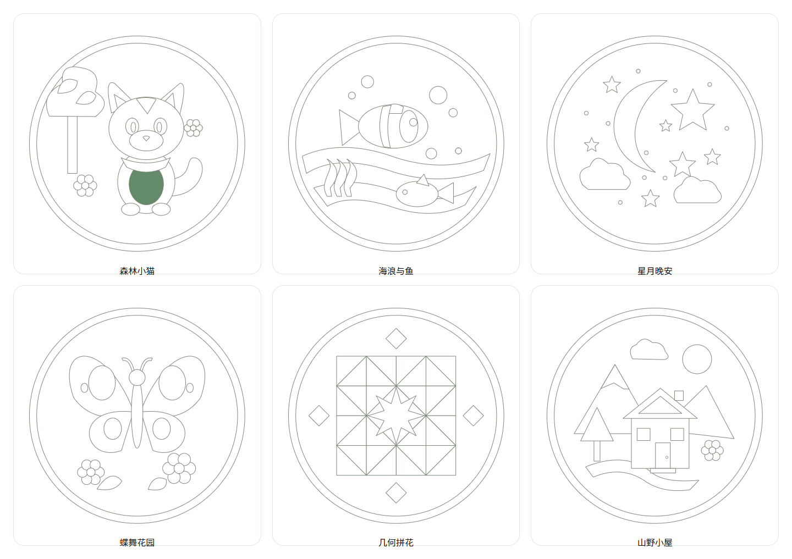
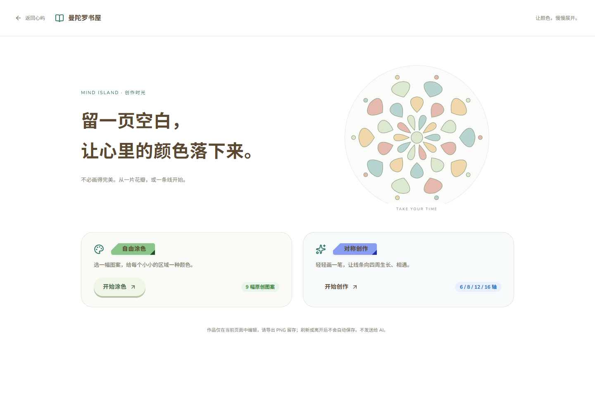
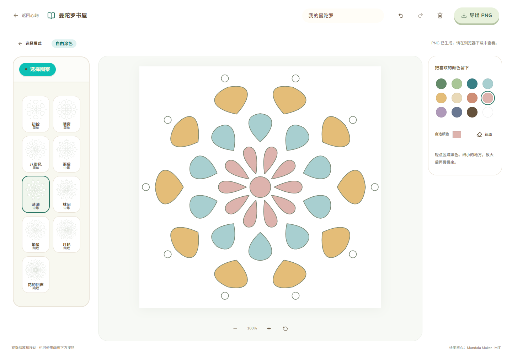

# Mind Island Demo V0.8.0：曼陀罗书屋

2026-10-25，本机完成，等待视觉与功能验收。

## 验收反馈后的调整

最新调整：只保留森林小猫、海浪与鱼、星月晚安、蝶舞花园、几何拼花、山野小屋六幅图案；移除“初绽”至“花的回声”九幅径向图案及全部难度标签。默认编辑状态、图案数量和数据测试同步更新，六图切换/填色、5 项曼陀罗测试、Biome 和 TypeScript / Vite 通过。[当前六图界面](screenshots/mandala-six-patterns.png)。

下文保留此前逐次交付记录。

- 桌面三岛的 Z 坐标统一为 `-1.8`，书屋 `[-16.6,0,-1.8]`、心屿 `[-5.8,0,-1.8]`、沙屿 `[5.4,0,-1.8]`。书屋与心屿相邻，两侧各有三朵云连接，所有模型和云仍共用运动父级。
- 手机以书屋、心屿、沙屿纵向排列，分别使用 `[-16.1,0,-6.68]`、`[-5.8,0,-1.8]`、`[4.5,0,3.08]`。增加竖向场景空间、为底部视角工具预留取景余量；地图与云连接跟随相同布局。
- 模型实例和材质独立于响应式位置配置，尺寸变化不重新请求 GLB；包围盒计算改为模型局部坐标，避免桌面/手机往返时重复应用世界变换。未来导航数据必须使用相应布局，仍无行走控制器。
- 新增六幅原创封闭 SVG：森林小猫、海浪与鱼、星月晚安、蝶舞花园、几何拼花、山野小屋。新增题材优先展示，原九幅径向图案和 ID 保留，总计 15 幅。没有使用收费图像 API、外部图片或新增绘图库。
- 沙盘离开、换作品、新建和旧档导入的未保存确认，从 `window.confirm` 换成与书屋相同的 Animal Island UI Modal。取消保留当前场景，确认才继续原操作；刷新保护仍用浏览器原生提示。没有改变保存 API、自动保存、revision、原始 HTML 或 SQLite。

本次修改：`IslandPreview/{island-world.ts,IslandScene.tsx,WorldCamera.tsx,CloudBridge.tsx,ArchipelagoMap.tsx,IslandPreviewPage.tsx,island-preview.module.css}`、`Sandplay/{useSandplayProjects.ts,SandplayPage.tsx}`、`Mandala/{illustrated-templates.ts,templates.ts,MandalaPage.tsx}`、两份前端测试与当前文档。没有修改任何 GLB。

实际回归：桌面与手机三岛完整可见，六朵云/两条连接正确；往返调整窗口后四个 GLB 均无额外请求，模型实例不变。小屿点击与手机触摸聊天、书屋点击/地图入口、插画独立填色/撤销/PNG 导出通过；六种新图案逐一渲染检查。沙盘 80 种沙具仍在，取消离开、保存失败后仍提醒、保存成功后直接离开、确认放弃和 Escape 关闭通过，离开后 iframe 卸载。浏览器 API 全部 Mock，未改用户数据或调用真实 AI。

岛屿 4 项、曼陀罗 5 项、沙盘桥接 4 项自动化测试及 Biome 63 文件、TypeScript / Vite 构建通过。仍保留既有 chunk 大小提示，实体手机待实际验收。



[对齐后的桌面群岛](screenshots/refinement-world-desktop.png) · [手机纵向群岛](screenshots/refinement-world-portrait.png) · [新图案填色](screenshots/refinement-coloring-cat.png) · [手机填色](screenshots/refinement-coloring-portrait.png) · [沙盘未保存卡片](screenshots/refinement-sandplay-unsaved.png) · [手机提醒卡片](screenshots/refinement-sandplay-unsaved-portrait.png)

实际入口：<http://127.0.0.1:5174/mandala>。根目录执行 `bun run dev:demo`，书屋编辑与 PNG 导出不需要后端。群岛新增书屋 3D 点击入口、地图入口和 HTML 快捷链接；返回 `/island-preview`。

## 范围与数据边界

实现自由涂色和对称创作两种完整模式，没有暂缓的不可用入口。没有新增 npm 依赖，没有修改 AI、沙盘、记忆或数据库业务；没有调用 DeepSeek。保留原有所有未提交改动，未提交或推送 Git。

作品只存在当前 React 页面内存中，未接入 SQLite、localStorage 或 IndexedDB。页面明确显示“仅当前页面 · 请导出留存”，不显示永久保存。未导出的非空作品在切换图案、返回模式、路由离开和浏览器刷新时提示；确认离开或刷新后清除。

导出 PNG 只保留图像，不是可重新编辑的数据存档；没有宣称 PNG 能恢复笔画。下一轮可基于已有纯数据序列化接口接入作品库，本轮不修改沙盘表。

## 开源复用与 UI

已检查 [Mandala Maker 源码](https://github.com/evoluteur/mandala-maker/tree/bbc8f445af13d68a21b81d49b469a71fb6055bdb)、README、package.json 与 LICENSE。

- 精确 commit：`bbc8f445af13d68a21b81d49b469a71fb6055bdb`。
- 上游版本 1.0.0，无运行依赖、无构建步骤，MIT，Copyright (c) 2026 Olivier Giulieri。
- 复用 `js/mandala.js` 的 `traceSmooth`、`drawStrokeOnce` / `drawStrokes`、`toStrokeCoords`、`savePng` 核心逻辑：二次曲线平滑、半径为 1 的归一化坐标、旋转和镜像重复、离屏缓存、2048px 导出。
- 适配为 TypeScript 的 `symmetry-engine.ts`，明确函数参数，不使用上游 DOM ID、全局 settings、自动浏览器存储、暗色主题或随机图案功能。
- 每笔保存自己的轴数和镜像参数，设置只影响下一笔；撤销历史由 React 管理。取消指针丢弃未完成笔画，而非沿用上游 pointercancel 即提交的行为。
- 审阅了上游 SVG 导出，但本轮 UI 仅提供所要求的 PNG；未声称已接入 SVG 导出、彩虹笔或视频。
- 完整 MIT 文本在 `frontend/public/licenses/mandala-maker-MIT.txt`，编辑器提供署名链接，核心代码头保留来源和 commit。

沿用实际安装的 `animal-island-ui@2.3.0`，未升级。实际使用 Button（经 `IslandButton` 适配）、Card、Title、Tabs、Modal、Tooltip、Switch、Tag、Input；`animal-island-ui/style` 继续由现有 `main.tsx` 导入。颜色、字体及边框沿用 `--mi-*` 主题。颜色和宽度滑条采用带标签的原生控件，没有新增 UI 框架。保存状态使用可读的行内 status，不新增通知动画。

## 自由涂色

9 幅程序化原创 SVG：初绽、晴窗、八瓣风、雨后、涟漪、林间、繁星、月轮、花的回声。覆盖简单、中等、细致三档，各 19–81 个独立封闭区域。不是外部图片或下载的第三方图案。

`templates.ts` 从固定参数生成数字路径和稳定 ID，不读取任意 SVG、HTML、脚本或远程引用。每个区域支持鼠标、触摸和键盘 Enter / Space 填色；细小区域可放大后操作。

支持 12 色调色板、自选色、单区还原、撤销/重做、二次确认清空、切换图案警告和 PNG 导出。画布支持 100–300% 缩放、双指平移/缩放、中键拖动及复位。双指手势不会同时填色。

保存数据为 `{version:1, mode:"coloring", templateId, fills}`，不保存 SVG DOM。

## 对称创作与性能

已接入 6 / 8 / 12 / 16 轴、镜像开关、颜色、笔宽、不透明度、撤销/重做、确认清空及 PNG。使用 Canvas 2D，不增加 WebGL Renderer。

笔画为 `{pts:[[x,y],...], w, a, color, folds, mirror}`；作品为 `{version:1, mode:"symmetry", strokes}`。`validateWork` / `serializeWork` 校验版本、图案、区域 ID、颜色、有限坐标与参数，并返回纯数据。没有 UI 导入任意 JSON 的入口。

- 每页最多 300 笔，总计 18,000 点，每笔最多 1,800 点，最多 60 步撤销。
- DPR 上限 2，编辑画布像素宽度上限 1200，导出固定 2048×2048。
- 已完成笔画缓存；新笔增量绘制，撤销或尺寸变化才重建缓存。指针采样放入 ref，只在完成笔画时更新 React 作品状态。
- 绘画只按需请求 animation frame，没有空闲持续渲染循环；卸载清理 ResizeObserver 和待执行帧。图片 Blob URL 使用后释放。
- 压力验证连续完成 300 笔约 6.42 秒，第 301 笔出现上限提示；撤销一次约 45ms，未发现页面错误。这是本机自动操作结果，不等于长期实体设备 FPS 保证。

## 小木屋资产检查与三岛入口

源文件可正常打开；原场景 636 个对象，包括 625 个 Mesh、3 个 Curve、5 盏灯、1 台相机、2 个探针。排除隐藏对象与 `Bg` 后导出 624 个可见 Mesh/Curve。地块、房屋、招牌和装饰均来自用户文件，没有制作替代岛屿。

唯一参与材质的地面图片已打包，可内嵌 GLB；缺失的旧 `D-NOISE Export` 文件没有被材质引用，不参与导出。将旧 Emission 节点转换为 Principled，未分配材质的部件补默认白色。仅在 Web 导出副本合并碎网格，保留材质分组以减少绘制调用；原始可编辑部件仍在 Blender 工程中。

| 资产 | 路径 / 结果 |
| --- | --- |
| 原始字节副本 | `assets/blender/islands/mandala/source/mandala_house.blend`；22,289,624 bytes，本机保留，和 Downloads 原件 SHA-256 一致 |
| 可编辑压缩工程 | `assets/blender/islands/mandala/source/mandala_house_compressed.blend`；890,633 bytes，纳入版本管理 |
| GLB | `frontend/public/models/islands/mandala-island.glb`；5,319,448 bytes（约 5.07 MiB） |
| 网格 | 72,843 三角面、13 材质，未导出相机、灯光或动画 |
| 原始包围盒 | Blender Z-up：`[-4,-4,-2.05863]` 至 `[4,4,6.55983]`，尺寸 `8×8×8.61846 m` |
| Three.js 布局 | Y-up，位置 `[1,0,-10.2]`，旋转 `[0,0,0]`，缩放 `0.85`；世界尺寸约 `6.8×7.326×6.8 m` |
| 导入验证 | 独立 Blender 场景重新导入；三角面、包围盒与材质槽检查通过；从压缩源重复导出也通过 |

原始字节副本超过现有 20 MiB 仓库限制，因此仅对这个精确路径 Git 忽略，另存压缩完整工程供版本管理，未放宽检查规则或删除原件。

导出实际命令：

```powershell
& 'C:/Program Files/Blender Foundation/Blender 5.2/blender.exe' --background --factory-startup --disable-autoexec --python assets/blender/islands/mandala/scripts/export_mandala.py
```

三岛继续复用同一 Canvas、世界运动父级和原正交相机自适应逻辑。命中代理尺寸来自配置，避免对完整房屋装饰射线拾取。原心屿、沙屿、角色 GLB 均未修改。未增加寻路或角色跨岛控制，云朵仍为原有三朵。

## 文件清单（本轮增量）

新增：

- `frontend/src/components/Mandala/`：`MandalaPage.tsx`、`MandalaSettings.tsx`、`MandalaTools.tsx`、`ColoringCanvas.tsx`、`SymmetryCanvas.tsx`、`CanvasViewport.tsx`、`useMandalaHistory.ts`、`templates.ts`、`mandala-data.ts`、`symmetry-engine.ts`、`mandala-export.ts`、`mandala.module.css`。
- `frontend/src/routes/mandala.tsx`、`frontend/tests/mandala.test.mjs`、MIT 文本。
- `assets/blender/islands/mandala/` 的工程、导出脚本、预览及验证记录；运行 GLB。
- 本报告及 `docs/screenshots/mandala-v080-*.png`。

修改：

- `IslandPreview/island-world.ts`：第三岛定义及配置化命中范围。
- `IslandPreview/IslandScene.tsx`：消费各岛命中范围，更新场景无障碍名称。
- `IslandPreview/IslandPreviewPage.tsx`、`ArchipelagoMap.tsx`、`island-preview.module.css`：群岛名称、书屋地图图标、快捷入口换行。
- `routes/__root.tsx`、生成的 `routeTree.gen.ts`：独立沉浸路由。
- `frontend/package.json`：检查范围及 `test:mandala`；现有 Demo CI 增加该测试，无部署修改。
- `.gitignore`：精确忽略超限原始副本；README、PROJECT_CONTEXT、DEVELOPMENT、CHANGELOG。

## 实际测试

| 项目 | 实际结果 |
| --- | --- |
| 书屋欢迎页 / 返回群岛 / HTML 和 3D 入口 | 通过；手机地图也能进入书屋 |
| 模板选择、独立填色、默认还原 | 通过；不同区域颜色独立 |
| 撤销、重做、取消/确认清空和清空后撤销 | 通过 |
| 切换模板与路由未导出提示 | 通过；取消不丢失编辑 |
| 原生刷新提示 | 通过；取消刷新保留编辑，确认刷新回到空白欢迎页 |
| PNG 实际下载 | 两模式均通过；PNG 文件签名有效，IHDR 实际为 2048×2048，内容非空 |
| 桌面鼠标与键盘区域填色 | 通过 |
| 触控笔 | Chromium CDP pen 模拟通过，不是实体笔实测 |
| 手机竖屏 / 横屏 | 390×844 与 844×390 触摸模拟通过，画布和操作区可见 |
| 双指缩放与移动 | 通过；不会误填色或提交笔画，包含抬起一根手指后继续停留的情况 |
| 触摸中断 | pointercancel 丢弃未完成笔画，通过 |
| 三岛初始取景 | 桌面和手机实际顶点投影均在可视区域内 |
| 原小屿聊天入口、沙屿和返回 | 通过；沙盘库仍为 80 种沙具，离开页面无残留 iframe / 世界 Canvas |
| 页面隐藏 | WebGL 帧数停止增长，通过 |
| 300 笔压力与限制 | 通过，详见性能段落 |
| 页面异常 | 验收浏览器未发现 pageerror |

自动化：新增曼陀罗 **5 项**、岛屿 **3 项**、沙盘桥接 **4 项**、仓库/原版资产 **7 项**全部通过；Biome **62 文件**、TypeScript / Vite 构建通过。新导出脚本 Ruff check / format 通过。仓库边界扫描通过（不包含明确忽略的原始超限副本）。

所有 API 请求在测试浏览器被拦截为 Mock 或空列表，未发送真实聊天、读取私人对话或写用户作品库。后端业务无改动，本轮未重新运行整套后端测试；没有据此宣称重新验收真实 AI 或持久化功能。既有数据库、API 配置和用户数据保持原位。

## 截图





[桌面对称创作](screenshots/mandala-v080-symmetry-desktop.png) · [手机涂色](screenshots/mandala-v080-coloring-portrait.png) · [手机横屏](screenshots/mandala-v080-coloring-landscape.png) · [手机对称创作](screenshots/mandala-v080-symmetry-portrait.png) · [桌面三岛](screenshots/mandala-v080-world-desktop.png) · [手机三岛](screenshots/mandala-v080-world-portrait.png)

## 已知限制与下一步

- 当前只有导出图像，没有可编辑作品的持久化；刷新确认后清除属预期行为。下一轮可在独立表/API 中保存已校验的版本化 JSON，不复用沙盘对象实例或表。
- 图案是简洁的原创几何花瓣，尚未加入更复杂的线描插画；小区域需要缩放。
- 三岛在手机初始全景中较小，可以通过现有群岛缩放和 HTML 入口操作；本轮没有加入寻路。
- 木屋保留用户模型原有英文招牌、造型和材质，没有改成新的建筑设计。
- 仅进行 Chromium 桌面/触摸模拟；实体手机、iOS Safari、实体压力笔和长时间真实创作仍待验收。
- 保留既有 3D chunk 超过 500 kB 和 THREE.Clock 弃用提示；未引入后处理或新 WebGL Canvas。木屋 GLB 首次加载约 5.32 MB，后续可单独评估压缩优化。

本轮停止于 V0.8.0，不开发 AI 绘画解释、心理分析、长期记忆或下一轮作品库。
