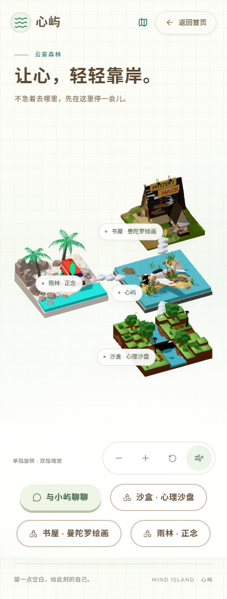
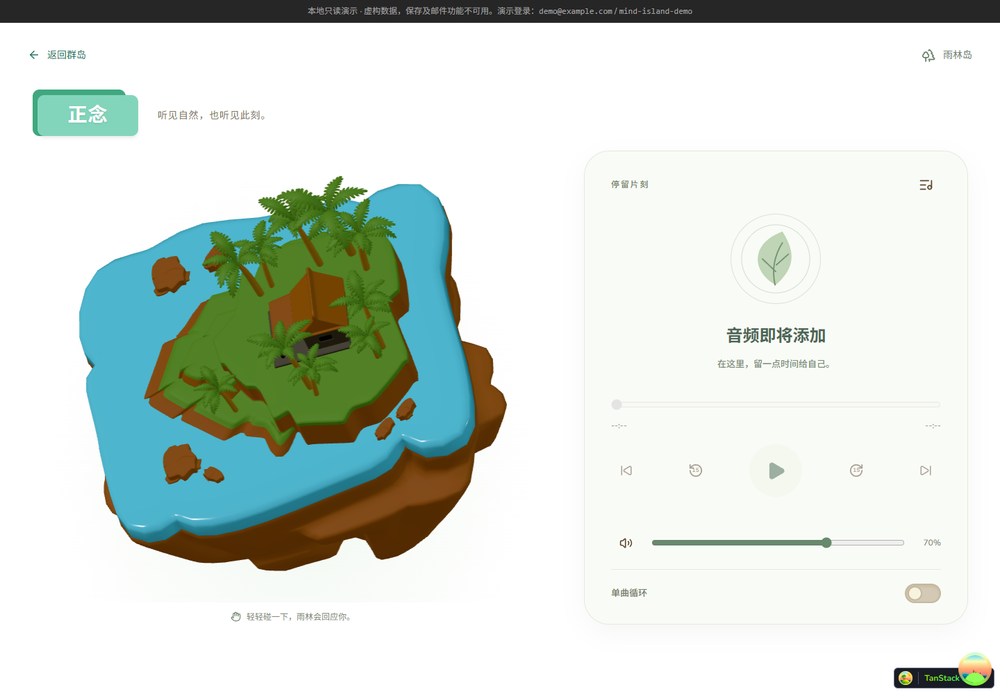
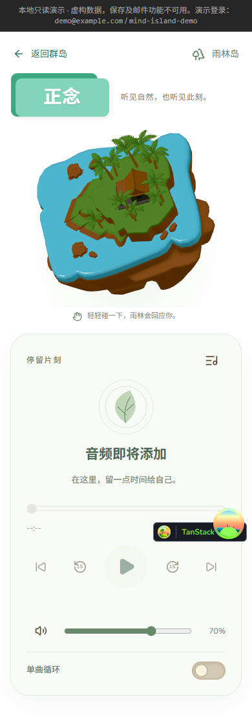
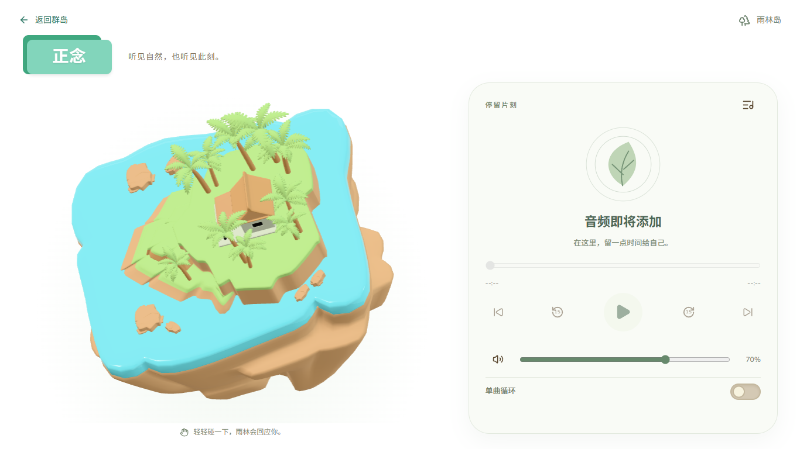
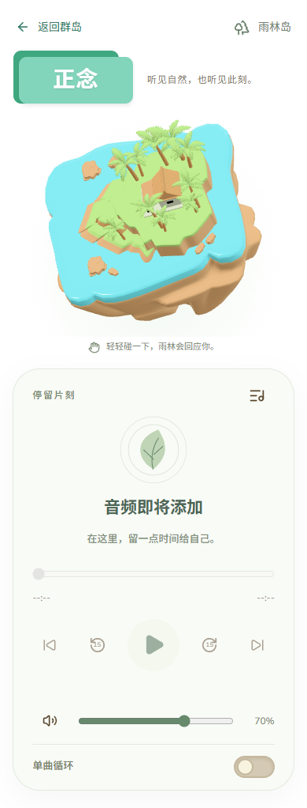

# Mind Island V0.9.0 · 雨林正念岛

验收日期：2026-10-25。本轮只增加功能岛与独立正念页面，没有修改 AI、记忆、沙盘、曼陀罗及数据库业务，没有调用真实供应商 API，没有安装新依赖。

## 访问与启动

- 群岛：<http://127.0.0.1:5174/island-preview>
- 正念：<http://127.0.0.1:5174/mindfulness>
- 根目录 `bun run dev:demo`。独立正念页面无需后端；聊天与作品库沿用在 `backend` 执行 `.venv-demo/Scripts/python.exe -m demo_ai` 的原有代理。

## 1. 用户模型与导出

按用户指定用途接入，未自建替代岛屿：

| 用户文件 | 保留的源副本 | 用途与 WebGL 文件 |
| --- | --- | --- |
| `Downloads/海滩小车.blend` | `assets/blender/islands/mindfulness/source/beach_home.blend` | 首页雨林入口，`frontend/public/models/mindfulness/beach-island.glb` |
| `Downloads/Island.blend` | `assets/blender/islands/mindfulness/source/rainforest.blend` | 正念近景，`frontend/public/models/mindfulness/rainforest.glb` |

Blender **5.2.3 LTS** 实际打开两份文件。副本与下载原件的 SHA-256 一致，导出脚本从未保存覆盖源工程。

- 海滩源场景共 72 对象，包含海岸地块、棕榈树、车辆、冲浪板、岩石和水面；排除背景、相机、灯光、探针、辅助空对象。
- Island 源场景共 19 对象，实际造型是棕榈林、微缩地形、水面及原有小建筑。保留用户造型，没有改造为另一种茂密雨林。排除相机、灯光和一个无面网格。
- 无源对象动画；网页动画独立实现。网格节点保留 `source_name` 和 `jelly_kind` 元数据。
- 海滩缺失的一个材质槽使用哑光奶油色补齐；发光节点转换为可导出的 Principled。水面关闭高成本真实透射，保留颜色。
- Island 的程序化树皮取原色带中间色作为平面材质；不依赖噪声节点、HDRI 或外部贴图。源文件的两张打包图片没有被模型材质使用，未随 GLB 导出。
- Island 的运行细分限制为 1，对密集树干、叶片和部分地形执行局部面数预算；首次导出 333,424 三角面 / 9.11 MB，最终减为 91,312 三角面 / 2.24 MB。源 .blend 保持可编辑。

| 最终资产 | 网格对象 | 三角面 | 材质 | 字节 | 实际 Y-up 尺寸（X / Y / Z） |
| --- | ---: | ---: | ---: | ---: | --- |
| 海滩入口 | 63 | 31,923 | 20 | 2,249,752（2.15 MiB） | 7.964 / 5.378 / 8.000 m |
| 正念近景 | 14 | 91,312 | 8 | 2,237,464（2.13 MiB） | 8.000 / 7.034 / 7.593 m |

导出统一到水平中心、约 8 m 宽，glTF 使用 Y-up，没有重复旋转。两份 GLB 均在独立 Blender 场景重新导入，三角面和包围盒匹配、材质存在、无相机和灯光，结果 `PASS`。机器可读结果：`assets/blender/islands/mindfulness/export-report.json`。

可重复执行命令（项目根目录 PowerShell）：

```powershell
& 'C:/Program Files/Blender Foundation/Blender 5.2/blender.exe' --background --factory-startup --disable-autoexec --python assets/blender/islands/mindfulness/scripts/export_mindfulness.py
```

## 2. 群岛配置与云朵

沿用一个首页 Canvas、现有正交相机取景、共用运动父级及低成本拾取代理。

- `island-world.ts` 增加 `mindfulness`，名称「雨林 · 正念」，路由 `/mindfulness`。
- 桌面书屋、心屿、沙盒沿原 X 轴对齐；海滩放在心屿后方 `[-5.8, 0, -13]`，组成世界坐标中的 T 字。原三岛位置与小屿出生点不变。
- 手机沿原三岛纵列增加侧枝海滩 `[-10.8, 0, 8.2]`，保留可辨认的模型尺寸，标签向内收以避免贴边。
- 心屿到海滩新增三朵云，共三条连接、九朵云，继续由单个 InstancedMesh 绘制 45 个云瓣。
- 原群岛相机按真实模型边界自动取景；新增入口同时出现在 HTML 快捷按钮及群岛地图，地图连线改为从心屿分别连接其他岛屿。
- 无角色行走系统；云朵是视觉连接，不声称可通行。沙盘、书屋和聊天入口保留。




## 3. 正念场景与弹性

桌面左侧约 57% 互动雨林、右侧约 43% 播放器；手机纵向排列，模型约 260–340 px 高，播放器随页面滚动。页面白底，局部浅薄荷渐层与单张主卡片。

- 正念路由才挂载独立 Canvas；首页场景离页卸载，二者不会叠加运行。
- 正交相机按实际顶点投影取景，避免棕榈树稀疏包围盒角落使模型过小。重算仅发生在初始化和尺寸变化，不逐帧扫描顶点。
- 模型按压采用根节点 squash/stretch 和小幅倾斜，支点位于模型底部；松开回到原位置。
- 局部部件系数：叶片 1、树干 0.12、地形 0.04、水面 0.035、岩石 0.025。叶片使用底部枢轴；不永久改几何或源 GLB。
- 按住模型后拖动产生倾斜，松开回弹；拖动空白处由 OrbitControls 旋转，滚轮/双指缩放受 0.8–1.35 限制，禁止平移。
- 连续按压限制位移与速度，不叠加无限冲量。固定子步最大 1/240 秒，长帧截断，避免失焦恢复时弹簧爆炸。
- 悬停只对被指向部件响应。播放时根节点极轻微呼吸、植被慢摆；暂停/结束时停止环境运动，主动弹性反馈仍可完成。

集中参数在 `jelly-spring.ts`：

| 参数 | 值 |
| --- | ---: |
| stiffness | 105 |
| damping | 7.8 |
| pressIntensity | 0.11 |
| wobbleAmplitude | 0.055 rad |
| settleThreshold | 0.00015 |
| hoverResponse | 0.018 |
| maxDisplacement / maxVelocity | 0.16 / 1.8 |

没有大型物理引擎、后处理或第二个装饰 WebGL Canvas。暂停音频时采用 demand 渲染，只在控制器/弹性未稳定时请求帧。后台页面 `frameloop="never"`；reduced-motion 关闭弹性、呼吸和摇摆。CPU 线程数不超过 4 的设备限制 DPR 为 1，仅计算叶片局部弹簧；其他设备 DPR 最大 1.5。

卸载通过既有资源租约释放克隆材质、源几何与加载缓存，兼容 StrictMode。实测离页旧场景 `internal.active=false`、几何计数 0、原生 WebGL context 已丢弃。Three 内部纹理统计仍显示 1，不将它误报为纹理计数清零；原生上下文已释放。

WebGL 或模型加载失败时显示实际模型静态预览，播放器独立可用；清理失败的 GLTF 缓存后可重试。

## 4. UI 与播放器

复用 **animal-island-ui 2.3.0**，未升级依赖。核对了本地类型声明/实现、[官方仓库](https://github.com/guokaigdg/animal-island-ui)与[设计系统](https://github.com/guokaigdg/animal-island-ui/tree/main/docs/design-system)。

实际使用：Button（经 `IslandButton` 保留 HTML 表单语义）、Card、Title、Tooltip、Switch、Tabs、Modal。沿用全局 `animal-island-ui/style` 和主题变量/字体。当前版本没有 Slider，播放进度与音量封装原生 range，提供键盘、触摸和无障碍名称。Progress 是只读展示，不用其冒充可拖动进度条。音频列表默认折叠在 Modal，避免常驻占据画布。

播放器和 3D 分开：

- `AudioController` 只管理一个 HTMLAudioElement、媒体事件、音轨切换与明确错误；不依赖 R3F。
- `useAudioController` 连接 React 生命周期，通过 `useSyncExternalStore` 读取真实媒体快照。3D 只接收是否正在播放，不控制音频。
- 支持播放、暂停、恢复、15 秒前后跳转、进度拖动、音量、静音、单曲循环、上一首/下一首、结束重播、加载失败和浏览器手势拒绝提示。
- 时间、时长来自真实媒体事件；跳转限制在实际时长范围。新音轨会暂停旧音轨，清除旧进度，不自动播放。
- 首次进入不自动播放；`play()` 从用户点击链直接调用，以适应 Safari 的手势限制。离页暂停、移除 src、重新 load 清理资源并移除监听。
- 当前正式清单为空：显示「音频即将添加」和 `--:--`，禁用播放、进度和跳转，不发出不存在的音频请求。音量、循环偏好和列表仍可操作。





## 5. 后续添加音频

文件放入 **`frontend/public/audio/mindfulness/`**，在 **`frontend/src/components/Mindfulness/mindfulnessTracks.ts`** 唯一清单中新增：

```ts
{
  id: "forest-01",
  title: "林间片刻",
  description: "这里填写音频的真实说明",
  category: "nature", // 引导练习使用 guided
  src: `${import.meta.env.BASE_URL}audio/mindfulness/forest-01.mp3`,
}
```

只有实际提供且获授权的文件才加入清单。不要猜测或硬编码时长。示例名称不代表当前已有该音轨；正式文件数量目前为 0。MP3/M4A 兼容性应优先在目标设备测试。旁边 README 提供相同接入说明。

## 6. 新增及修改文件

新增：

- `frontend/src/components/Mindfulness/`：`RainforestPage.tsx`、`RainforestScene.tsx`、`JellyInteraction.tsx`、`jelly-spring.ts`、`MindfulnessPlayer.tsx`、`AudioController.ts`、`useAudioController.ts`、`TrackList.tsx`、`mindfulnessTracks.ts`、`useSceneEnvironment.ts`、`mindfulness.module.css`。
- `frontend/src/routes/mindfulness.tsx`、`frontend/tests/mindfulness.test.mjs`。
- `frontend/public/models/mindfulness/` 两份 GLB 与 `rainforest-preview.png`。
- `frontend/public/audio/mindfulness/README.md`。
- `assets/blender/islands/mindfulness/`：两份源文件、可重复导出脚本、预览 PNG、`export-report.json`。
- 本报告和 `docs/screenshots/mindfulness-v090-*.png` 四张截图。

修改：

- `island-world.ts`：第四岛、T 字布局、第三条云连接。
- `ArchipelagoMap.tsx`：地图改为心屿放射连接。
- `IslandScene.tsx`：无障碍入口说明增加正念。
- `frontend/src/routeTree.gen.ts`：由现有 TanStack 插件生成路由。
- `frontend/tests/island-world.test.mjs`：四岛与分枝布局检查。
- `frontend/package.json`、`.github/workflows/demo-ci.yml`：增加 scoped 检查与新测试命令。
- `docs/PROJECT_CONTEXT.md`、`docs/DEVELOPMENT.md`：更新当前入口与音轨配置。

原有未提交改动全部保留；本轮没有提交或推送。

## 7. 实际测试结果

| 检查 | 实际结果 |
| --- | --- |
| Blender 两模型加载、预览、独立重新导入 | 通过；源文件 SHA-256 与原件一致 |
| TypeScript + Vite build | 通过；保留 Three 共享 chunk 超过 500 kB 的警告 |
| `bun run --filter frontend check:demo` | 75 文件通过，无自动 unsafe fixes |
| `test:mindfulness` | 10 项通过：空清单、真实事件状态、跳转、切换/清理、错误、过时 Promise、结束/重播、缓冲取消、弹簧稳定及 GLB |
| `test:islands` / `test:mandala` / `test:sandplay` | 4 / 5 / 4 项通过 |
| 后端 `unittest discover -s demo_ai/tests -v` | 98 项通过，使用测试夹具/隔离 SQLite 和 Mock |
| Ruff check + format --check | 通过，28 文件已符合格式 |
| `scripts/tests` | 7 项通过，包括 V15 原版校验、80 工厂与九分类 |
| `scripts/check_repository.py` | 通过；无密钥、数据或大文件违规 |
| Edge 桌面 1440×1000 / 触摸模拟 390×844 / 窄屏 320×740 | 无横向溢出，导航、列表、播放器正常 |
| 真实模型点击/拖动/释放 | 按压位移实测约 -0.113，松开后位移/倾斜归零、缩放 `[1,1,1]`；连续 14 次点击保持边界 |
| 手机模型触摸 | 实测非零压缩约 -0.073，随后恢复 |
| reduced-motion / WebGL 不可用 | 零压缩；真实静态模型与播放器可见 |
| 模型 503 后重试 / 低性能 / 后台 / 离页 | 重试成功、DPR 1、后台 never、旧 WebGL context 释放 |
| 海滩 3D 悬停→点击→正念→返回 | 通过；对应 HTML、地图入口保留 |
| 原聊天与书屋 | Mock 环境打开/关闭聊天、书屋导航正常；历史/记忆/沙盘业务由原自动化测试回归，未做真实 AI 请求 |

播放器使用本地产生的 **40 秒静音 WAV**，通过只在测试浏览器中的资源清单拦截接入；文件在忽略目录 `output/mindfulness/`，没有放入正式曲库或 Git。桌面及触摸模拟均实际验证：播放/暂停、15 秒前后跳转、0–40 秒边界、range 跳转、音量 25%、静音、loop 属性、切换不双播、结束重播、404 错误提示、离页音频暂停且移除 src。

测试中发现初始模拟音频响应不支持 Range，浏览器报告 `seekable=[0,0]`；改由 Vite 实际提供测试 WAV 后报告 `[0,40]`，正常跳转。没有把测试服务问题当成播放器修复。另修正了结束后手动移回进度时的播放按钮状态，并单测覆盖缓冲时取消播放。

浏览器验证脚本/日志在忽略目录 `output/mindfulness/`（`scene-qa`、`audio-qa`、`audio-portrait-qa`、`lifecycle-qa`），没有聊天内容或 API Key。正常场景检查无 pageerror；WebGL 初始化失败与 503/404 测试的预期错误单独验证。

## 8. 限制与后续

- 正式音频尚待用户提供；本轮交付完整播放架构与空状态，不声称已有正念内容。
- 已验证桌面 Edge 与手机触摸模拟，**未使用实体 iPhone/Safari 或 Android 手机**。iOS 系统音量控制、静音开关、后台音频策略、来电中断仍需实机验收；浏览器可能由系统控制音量。
- CPU 线程数是保守简化指标，不等同于实机 FPS 验收；没有声称所有低端设备达到固定帧率。
- 当前为有界根变换加部件弹簧，不是软体物理或局部顶点 Shader。源模型的薄叶片保持原样，近看仍有其原始细节特征。
- 首页沿用现有材质和灯光，海滩源色偏鲜亮；如视觉验收需要统一色板，可只调整克隆材质，不覆盖源文件。
- Three.Clock 弃用与大型 3D chunk 提示来自现有依赖路径；没有为了本轮升级依赖或拆改其他模块。
- 无音频分析、心理推断、AI 冥想、自动保存正念记录或新数据库结构。

## 9. 2026-10-26 · 一屏布局与光照调整

- 电脑端改为按 `100dvh` 分配导航、标题与双栏剩余空间，雨林画布随可用高度取景，播放器缩减装饰留白；矮窗口隐藏叶片图案和辅助说明，保留所有操作。没有通过隐藏溢出来裁掉控件。手机维持纵向可滚动布局。
- 实际验证 1440×1000、1366×768、1280×720、1280×600、1024×768、800×600：页面 scrollHeight 等于窗口高度，全部播放器按钮和滑块均在窗口范围内。390px 手机无横向溢出。
- 新增 `rainforest-look.ts`，仅提亮运行时克隆材质的植被、土壤、木材与岩石，源 GLB/.blend 未改。水面使用浅青蓝、roughness 0.08、metalness 0.03 与环境高光；植被和地形保持哑光。
- 增强柔和补光，并使用现有 Drei Environment / Lightformer 在 128 分辨率下捕获一次静态灯光。无 HDR 下载、无持续实时反射、无额外 WebGL Canvas；独立 memo 组件避免音频进度更新触发重复捕获。
- `/mindfulness` 加入已有沉浸页面列表，隐藏开发工具悬浮入口以免遮挡播放器。
- Biome 76 文件、TypeScript/Vite 构建、10 项正念测试通过。模型失败重试、DPR 1、后台停止渲染和离页释放再次通过；新增环境后旧渲染器纹理统计为 3，但场景 inactive、几何计数 0、原生 WebGL context 已释放。
- 用户已取消关机请求，没有执行或安排关机。





到此停止，等待视觉与交互验收。
