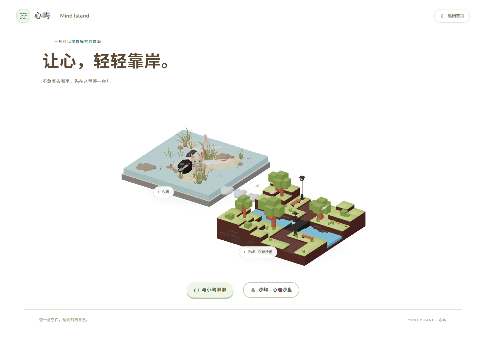
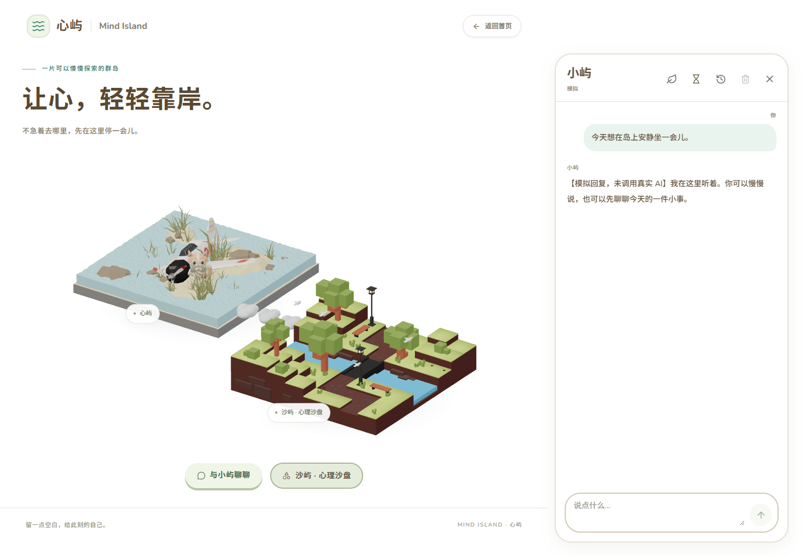

# Animal Island UI 接入记录

2026-10-25。基于当前 V0.7.2 做界面改版，不增加业务功能。

## 实际组件与边界

实际安装并使用 `animal-island-ui@2.3.0`，不是只模仿颜色。直接依赖补充 `classnames@2.5.1` 以满足其 peer dependency；锁文件新增传递依赖 `dayjs@1.11.23`、`naive-icons@1.7.0`。React、Three.js 和后端版本不变。

| 组件 | 实际使用位置 |
| --- | --- |
| Button | 首页聊天、聊天工具栏、发送/停止、历史操作、记忆编辑与授权、沙盘作品管理 |
| Input | 历史会话重命名、作品命名和重命名 |
| Switch | 自动记忆、使用已有记忆，均为受控开关 |
| Card | 记忆设置、记忆条目、沙盘作品条目 |

`src/components/IslandUI/IslandButton.tsx` 封装实际库 Button：将现有原生 `type` 转为库的 `htmlType`，`variant` 表示视觉类型，避免替换后表单意外提交。当前项目使用 React 19，固定版本的库会把 ref 传入原生 button；适配层补足其声明缺少的 ref 类型，并通过浏览器验证关闭、返回及焦点恢复。

继续保留原生多行 textarea 的中文输入法与 Shift+Enter 行为，以及现有 Radix Dialog 的焦点、关闭和删除确认机制。路由入口保持语义化链接。没有改写聊天 hook、流解析、Provider、数据库或沙盘 iframe 桥接。

## 视觉适配

设计参考：[Animal Island UI 设计规范](https://github.com/guokaigdg/animal-island-ui/tree/main/docs/design-system)。采用库自带的 Nunito / Noto Sans SC 字体、圆润形状、暖棕文字、柔和绿色及主按钮的轻微立体反馈。

- 页面及面板保持白色；只在消息气泡、选中项和主按钮上使用浅色。
- 首页保持双岛、三朵悬浮云和当前极简内容；暂停、岛屿信息按钮及编号未恢复。
- 聊天不恢复角色介绍、欢迎语或输入提示；历史、临时模式、记忆与错误反馈保留。
- `island-theme.css` 集中管理共享 token、库变量覆盖、按钮内容布局和减少动态设置。
- 三个功能 CSS Module 只负责各自的排版与局部状态；未覆盖模板管理后台的组件体系。
- 原 V15 HTML 和其沙具、模型、手势均未修改；本轮改造沙盘外层和作品管理。

## 验证结果

使用独立 `127.0.0.1:8002` Mock 代理和 `output/ui-animal/ui-final-03.sqlite3`，所有浏览器测试 API 请求受控转发到该代理。真实模型调用 0 次，未向正式 SQLite 写入测试数据。测试进程完成后关闭，原 5174 前端和 8001 代理保留运行。

- TypeScript + Vite build：通过；生产 CSS 中实际包含库 Button、Switch 和主题规则。
- `bun run --filter frontend check:demo`：45 文件通过，无新增规范警告。
- `test:islands`：3 项通过；`test:sandplay`：4 项通过。
- 仓库/资产测试：7 项通过，含 V15 原文件字节完整性；仓库检查通过。
- 浏览器：实际 Button / Input / Switch / Card 类名检查通过。
- 聊天：发送、Mock SSE 回复、停止生成、临时聊天切换、关闭焦点恢复通过。
- 历史：会话重命名和原生表单提交通过。
- 记忆：默认关闭、开启前授权、取消授权、手动新增/编辑/删除通过。未放宽保存规则。
- 作品：三作品独立保存、刷新准确恢复、自动保存、失败重试、重命名、删除确认通过。
- 手机竖屏：聊天输入、工具栏和作品抽屉无横向裁切；导航与返回通过。
- 减少动态：库按钮的 transition 与 hover transform 关闭，原场景设置继续保留。
- 正常测试未见页面运行异常。后端实现未修改，本轮未重新执行全套后端单元测试。

## 文件

新增 `frontend/src/components/IslandUI/{IslandButton.tsx,island-theme.css}`、`frontend/public/licenses/`、本记录及 `docs/screenshots/animal-ui-*.png`。

修改 `frontend/package.json`、`bun.lock`、`src/main.tsx`、`src/vite-env.d.ts`；Chat 目录中的表现组件与 CSS；SandplayPage、ProjectLibrary 与 CSS；IslandPreviewPage 与 CSS。保留所有此前未提交的业务改动。

另外为记忆编辑框和分类补充稳定的可访问名称，避免编辑已有文本时标签匹配不稳定。没有添加长期记忆、账户或其他业务能力。

## 截图

[手机首页](screenshots/animal-ui-home-portrait.png) · [手机聊天](screenshots/animal-ui-chat-portrait.png) · [历史列表](screenshots/animal-ui-history-desktop.png) · [记忆信箱](screenshots/animal-ui-memory-desktop.png) · [桌面作品库](screenshots/animal-ui-works-desktop.png) · [手机作品库](screenshots/animal-ui-works-portrait.png)

## 体积及许可

库的全量样式约 132 KB（未压缩），捆绑字体约 3.56 MB，其中中文字体为主要部分；字体由本地静态资源加载，不依赖 Google Fonts 请求。首次中文字体加载会增加网络成本，系统字体作为回退。本轮先保留库的官方字体，后续可按实际网络指标选择字体子集。原 3D chunk 仍约 1.06 MB，有既有 Vite 大包提示。

库及图标等 MIT 版权声明、两套字体的 OFL 声明放在 `frontend/public/licenses/`，构建时随静态资源输出。项目原始 LICENSE 与 FastAPI 模板署名保留。

原生多行输入与 Radix 弹窗有意保留，不宣称所有界面控件都已替换为该库。手机横屏与实体软键盘仍不在本轮专项范围，等待用户视觉验收。
