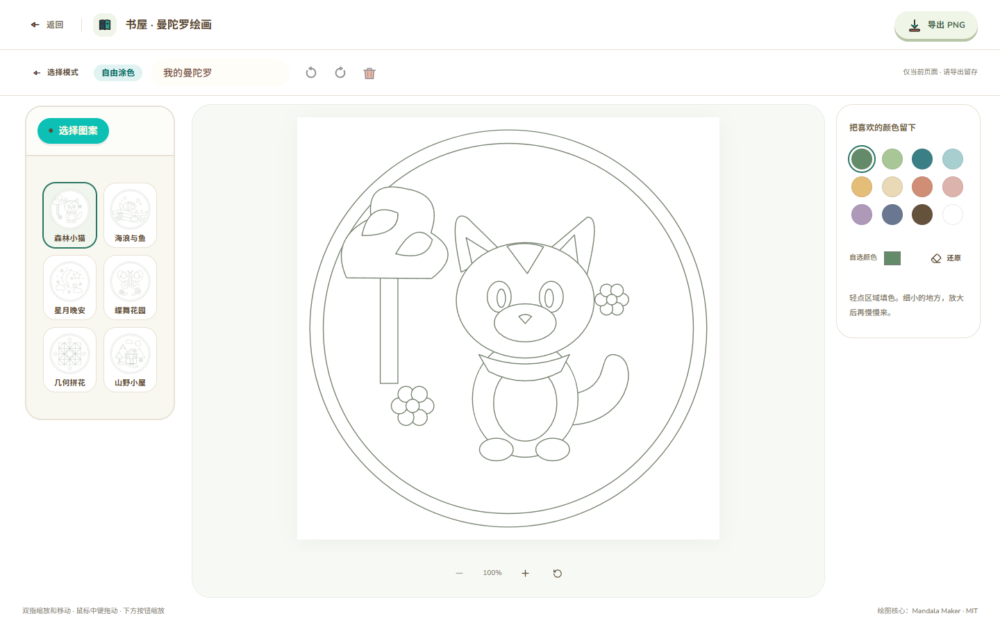
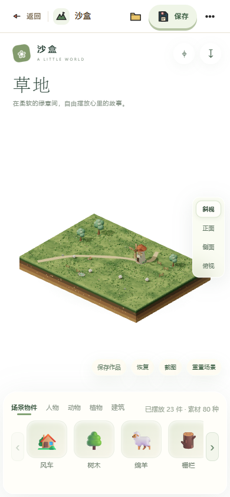

# Animal Island 统一导航 · V1 视觉实验

日期：2026-10-26。本轮范围为四个产品页面的共用导航、相邻编辑工具布局和配套图标；没有修改后端、数据库、GLB、聊天/记忆、沙盘运行源码或绘画算法。

## 版本对照

实施前先把当前完整 V0.9 工作区提交并上传，再建立独立实验分支。

- 原版提交：[`9466f5b`](https://github.com/sundiary1/AIaccompany/commit/9466f5ba7bc412e9d489d2707ff5c5aaeed1302b)。
- 原版标签：[`v0.9.0-before-unified-navigation`](https://github.com/sundiary1/AIaccompany/tree/v0.9.0-before-unified-navigation)，已上传；`main` 保留此版。
- 新版分支：[`codex/unified-navigation-v1`](https://github.com/sundiary1/AIaccompany/tree/codex/unified-navigation-v1)。新版单独提交，不合并 main，等待视觉验收。
- 快照包含此前累计的功能、源码和必要资产；提交前 `scripts/check_repository.py --staged` 487 文件通过。密钥、SQLite、原始浏览器录制、构建和缓存未入库。

本地当前分支为新版，使用原 `bun run dev:demo` 即可预览。没有通过 reset 或 force-push 重写历史。

## 统一规则

`frontend/src/components/IslandUI/PageHeader.tsx` 提供共享布局、真实 Animal Island 按钮和“更多操作”弹窗，`page-header.module.css` 管理单一尺寸规则。

- 电脑导航高 72px、手机高 56px，额外适配安全区域；统一白底、暖棕字体、薄分隔线、薄荷图标底色和 40px 按钮。
- 首页左侧保留“心屿 / Mind Island”，右侧为“群岛地图”。移除跳向模板后台的“返回首页”；模板路由仍完整保留，未删除管理功能。
- 三个功能页统一为“返回 / 分隔 / 功能图标 / 页面名称”，右侧只放必要动作。可见返回文字统一“返回”，无障碍名称为“返回群岛”。
- 电脑显示完整功能名，手机分别简写为“沙盒”“书屋”“正念”。导航标题不因进入编辑状态消失或被挤成两行。
- 沙盒保留作品库、保存和另存为；手机“另存为 / 沙盘设置”放入真实 Modal 的“更多操作”，不删除原命令。
- 书屋导出保留在导航，作品名、撤销/重做/清空移到下方工具栏，模式与设置仍可用。原有操作回调、绘画状态和离开提醒保持。
- 正念去掉重复的“雨林岛”和内容区大标题，直接显示“雨林 · 正念”；电脑端继续一屏完整展示模型和播放器。
- 返回通过 TanStack navigate，仍经过原 useBlocker 与保存/导出提醒，没有直接改写 window.location 绕过保护。

## 组件与图标来源

继续使用 `animal-island-ui@2.3.0` 的 Button（项目 IslandButton 适配）、Tooltip、Modal 与既有 Input、Tag；保留 `animal-island-ui/style`、主题变量和字体，不升级 UI 库。

图标改用 Animal Island UI 已经依赖、同作者提供的 [Naive Icons](https://github.com/guokaigdg/naive-icons)，核对已安装版本为 **1.7.0**。为了明确直接使用关系，将它固定声明为前端直接依赖；锁文件只新增工作区依赖声明，没有升级原有传递依赖或引入新框架。

`island-icons.ts` 使用命名导出，保留 tree shaking。实际用于：

| 场景 | 配套图标 |
| --- | --- |
| 返回 / 更多 | ArrowLeftIcon / EllipsisIcon |
| 首页品牌 / 群岛地图 | SailboatIcon / MapIcon |
| 沙盒 / 书屋 / 正念 | MountainIcon / BookIcon / TreeIcon |
| 作品库 / 保存 / 另存为 | FolderIcon / SaveIcon / CopyIcon |
| 导出 / 撤销 / 重做 / 清空 | DownloadIcon / UndoIcon / RedoIcon / TrashIcon |
| 设置 / 聊天 / 群岛视角操作 | SettingsIcon、SlidersIcon、ChatIcon、PlusIcon、MinusIcon、RefreshIcon、LeafIcon |

保留图标原有手绘路径和彩色填充，没有用自绘 SVG 冒充配套组件。MIT 许可在 `frontend/public/licenses/naive-icons-MIT.txt`。其他模块原有图标未做无关的全面替换，例如播放器内部仍沿用原图标。

## 页面预览

| 页面 | 电脑 | 手机 |
| --- | --- | --- |
| 群岛 | [截图](screenshots/navigation-v1-world-desktop.png) | [截图](screenshots/navigation-v1-world-portrait.png) |
| 沙盒 | [截图](screenshots/navigation-v1-sandplay-desktop.png) | [截图](screenshots/navigation-v1-sandplay-portrait.png) |
| 书屋欢迎页 | [截图](screenshots/navigation-v1-mandala-desktop.png) | [截图](screenshots/navigation-v1-mandala-portrait.png) |
| 书屋编辑页 | [截图](screenshots/navigation-v1-mandala-editor-desktop.png) | [截图](screenshots/navigation-v1-mandala-editor-portrait.png) |
| 正念 | [截图](screenshots/navigation-v1-mindfulness-desktop.png) | [截图](screenshots/navigation-v1-mindfulness-portrait.png) |

## 实际验证

- Edge 桌面 1440×900、触摸模拟 390×844：四页面及书屋编辑状态顶部均为 72 / 56px，导航按钮都在栏内，无横向溢出；320px 沙盒也无溢出。
- 首页地图打开/关闭、聊天打开/关闭、功能入口和返回群岛通过。
- 书屋真实 SVG 区域填色、撤销、重做、未导出返回提醒和实际 PNG 下载通过；编辑字段已不在顶栏。
- 沙盒保留 80 种沙具，增加物件后返回仍弹未保存提醒；手机更多→设置可用、更多→另存为可用，Mock 503 保存失败提示与重试成功通过。
- 正念在 1440×1000、1366×768、1280×720、1280×600、1024×768、800×600 下无页面滚动，播放器操作全部在视窗内；水面环境和材质保持。
- 上述浏览器请求由独立上下文 Mock，不读写正式用户数据，不调用真实 AI。正常场景无 pageerror。
- `bun run --filter frontend check:demo`：79 文件通过。
- TypeScript / Vite build：通过；保留现有大型 Three.js 共享 chunk 提示。
- `test:mindfulness` / `test:islands` / `test:mandala` / `test:sandplay`：10 / 4 / 5 / 4 项通过。
- `scripts/tests`：7 项通过，包括原版 V15 校验与 80 工厂 / 九分类。
- `scripts/check_repository.py`：通过；提交前再次执行 staged 检查。
- 本轮没有后端变更，未重复运行后端测试，也未安装其他运行环境。

## 文件范围与限制

新增 PageHeader、统一导航 CSS、图标命名导出文件、图标许可及本报告/截图；四个 Page 组件和对应样式复用它们，并清理旧导航专用 CSS。`frontend/package.json` / `bun.lock` 只明确声明现有图标依赖；README 和 PROJECT_CONTEXT 增加实验入口。

手机仍是浏览器触摸模拟，尚待实体手机视觉验收。小于 360px 时隐藏装饰图标以保留返回、标题和操作空间。未改登录、注册、密码恢复与模板管理界面；本轮先统一面向用户的四个功能页面。

当前是可回退的视觉实验，不继续其他业务开发，也没有安排关机。
